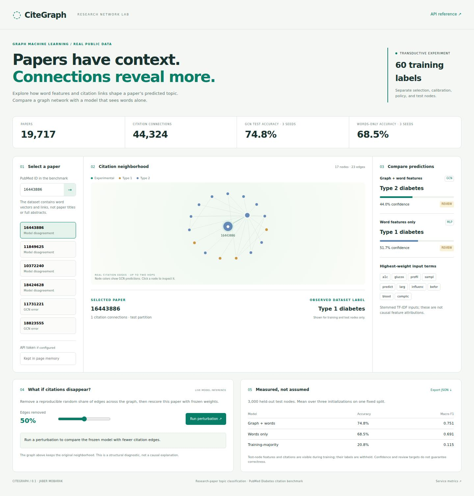

# CiteGraph

**Classify papers with words and citations. Inspect where the models disagree.**

CiteGraph trains a graph convolutional network on a real scientific citation network, compares it with a feature-only neural baseline, and serves both in a local browser workspace. Select a paper, inspect its neighborhood, compare predictions, or remove citation edges and run the frozen model again.



## Measured results

Real PubMed Diabetes data: **19,717 papers**, **500 word features**, **44,324 unique undirected connections**. Only **60 topic labels** are used for training.

| Model | Test accuracy, mean of 3 seeds | Macro F1 |
|---|---:|---:|
| Graph + word features, GCN | **74.8%** | **0.751** |
| Word features only, MLP | 68.5% | 0.691 |

On this fixed split, the graph model gains **6.3 percentage points**. The predeclared release seed reaches 75.0% overall accuracy. Its review policy accepts 36.7% of test nodes at 91.8% accepted accuracy; the rest need review. The MLP does not meet the policy-set target and routes all cases to review.

These are transductive results on 3,000 test nodes: all paper features and citation links are visible during learning, while test labels are withheld. This is a custom split, not a standard leaderboard result or an evaluation on newly arriving papers. Full seed-level results, confidence metrics, confusion matrices, and edge-removal diagnostics are in [the report](artifacts/report.json).

## Run

Python 3.11 or 3.12. No GPU or API key required. The fitted models are included; dataset preparation downloads a verified 14 MB public archive once.

```bash
python -m venv .venv
# Linux / macOS
source .venv/bin/activate
# Windows PowerShell: .venv\Scripts\Activate.ps1
pip install torch --index-url https://download.pytorch.org/whl/cpu
pip install -e '.[dev]'
python -m citegraph.cli prepare
python -m uvicorn citegraph.api:app --host 127.0.0.1 --port 8000
```

Open **http://localhost:8000**. The example buttons include model disagreements and actual GCN errors. Paper IDs, word features, and citation connections come from the dataset; the app does not invent titles or abstracts.

Or:

```bash
docker build -t citegraph .
docker run --rm -p 127.0.0.1:8000:8000 citegraph
```

The container downloads the verified dataset during its build and runs inference as a non-root user.

## What is implemented

- Sparse graph normalization and two-layer GCN in plain PyTorch.
- Feature-only MLP and training-majority baselines.
- Disjoint training, checkpoint selection, temperature fitting, policy selection, and final-test labels.
- Three model seeds, a fixed release seed, and frozen edge-removal stress tests.
- Safe tensor weights, source/cache/model checksums, and prediction parity checks.
- FastAPI, bounded neighborhood responses, validated perturbation requests, optional bearer access, process metrics, Docker, and CI.
- A working graph viewer, prediction comparison, input-term inspection, and JSON export.

Graph colors represent predictions. Top word weights show model inputs, not causal explanations. The graph viewer caps the display at 51 nodes; inference uses the full graph.

## Reproduce

```bash
python -m citegraph.cli prepare
python -m citegraph.cli train
python -m citegraph.cli verify
python -m pytest -q
python scripts/check_release.py
```

Training rebuilds the committed weights, predictions, and report. All three seeds use the same fixed split. Run-to-run variation across model initializations is not uncertainty across datasets; connected test nodes are correlated. See [protocol and limitations](docs/PROTOCOL.md), [data provenance](data/README.md), and [architecture](docs/ARCHITECTURE.md).

## API

| Endpoint | Purpose |
|---|---|
| `GET /api/overview` | Dataset, measured results, example IDs |
| `GET /api/node/{paper_id}` | Both model predictions and input terms |
| `GET /api/neighborhood/{paper_id}` | Bounded citation neighborhood |
| `POST /api/stress` | Real frozen inference after random edge removal |
| `GET /health` | Readiness |
| `GET /metrics` | Process-local aggregate counters |
| `GET /docs` | API schema |

Set `CG_API_TOKEN` to require `Authorization: Bearer <token>` on data routes and metrics. The browser token field holds the token in page memory. `CG_DATA` and `CG_ARTIFACTS` override the default local paths. Use a trusted model bundle. For shared hosting, add TLS, identity-based authorization, request limits, and workload controls. No clinical or production-use performance is claimed.

Original implementation by Jaber Mobarak · MIT code license. External dataset terms are separate.
